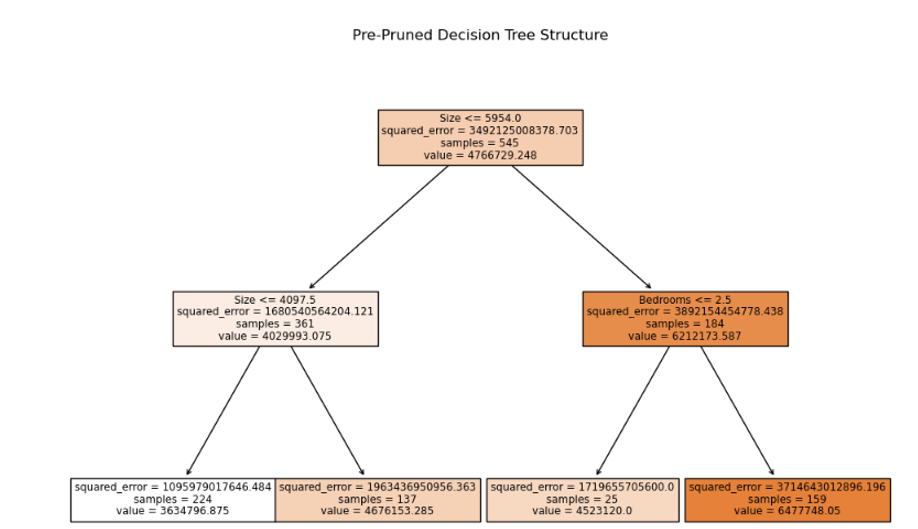
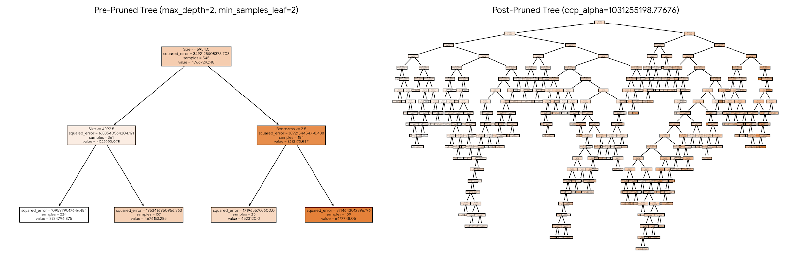

# Applied Machine Learning: Lab 08 - Decision Tree Models


An in-depth exploration of tree-based supervised machine learning algorithms using `scikit-learn`. This repository contains practical implementations of **Decision Tree Classification** and **Decision Tree Regression**, along with techniques for pre-pruning and post-pruning (Cost-Complexity Pruning) to mitigate overfitting.

---

## 📋 Table of Contents
- [Project Overview](#project-overview)
- [Lab Tasks & Methodology](#lab-tasks--methodology)
  - [Task 1: Multi-Class Iris Flower Classification](#task-1-multi-class-iris-flower-classification)
  - [Task 2: House Price Prediction via Decision Tree Regressor](#task-2-house-price-prediction-via-decision-tree-regressor)
- [Results & Performance Summary](#results--performance-summary)
- [Discussion & Key Insights](#discussion--key-insights)
- [Repository Structure](#repository-structure)
- [Getting Started](#getting-started)

---

## 🎯 Project Overview

Decision Trees are non-parametric supervised learning tools that learn simple, interpretable decision rules from dataset features. The objectives of this lab are:
1. Building a **Decision Tree Classifier** on 2D numerical feature spaces (Petal Length & Petal Width) to visualize non-linear decision boundaries.
2. Implementing a **Decision Tree Regressor** for continuous numeric target predictions.
3. Controlling model complexity using **Pre-Pruning** (`max_depth`, `min_samples_leaf`) and **Post-Pruning** (`ccp_alpha`).

---

## 🔬 Lab Tasks & Methodology

### Task 1: Multi-Class Iris Flower Classification

* **Dataset**: `Iris` (Built-in via `sklearn.datasets`)
* **Features Used**: Petal Length (cm) and Petal Width (cm) ($X \in \mathbb{R}^{150 \times 2}$)
* **Target**: Iris Species (`0: Setosa`, `1: Versicolor`, `2: Virginica`)
* **Objective**: Train a `DecisionTreeClassifier` with `max_depth=2` to classify new flowers based solely on petal metrics and visualize decision boundaries.

#### Implementation Highlights:
```python
from sklearn.datasets import load_iris
from sklearn.tree import DecisionTreeClassifier

iris = load_iris()
X = iris.data[:, 2:]  # Extract last two columns (Petal Length & Width)
y = iris.target

clf = DecisionTreeClassifier(max_depth=2, random_state=42)
clf.fit(X, y)
```

---

### Task 2: House Price Prediction via Decision Tree Regressor

* **Dataset**: `Housing.csv` (Features: `area`, `bedrooms`, `price`)
* **Features Used**: Size ($X_1$), Bedrooms ($X_2$)
* **Target**: House Price ($y$)
* **Objective**: Fit a `DecisionTreeRegressor` and compare model variance and bias across **Pre-Pruning** and **Post-Pruning** techniques.

#### Pruning Techniques Applied:
1. **Pre-Pruning**: Setting structural boundaries early (`max_depth=2`, `min_samples_leaf=2`).
2. **Post-Pruning**: Generating the Cost Complexity Pruning path (`cost_complexity_pruning_path`) and evaluating effective $\alpha$ (`ccp_alpha`) parameters on an unconstrained tree.

---

## 📊 Results & Performance Summary

### Task 1: Iris Classification Results
* **Training Accuracy**: `96.00%`
* **Sample Inference (`Petal Length = 5.0 cm`, `Petal Width = 1.5 cm`)**:
  * **Predicted Class**: `Iris-versicolor`
  * **Class Probabilities**: Setosa: `0%`, Versicolor: `90.74%`, Virginica: `9.26%`

---

### Task 2: Housing Regression Results

#### Model Performance Metrics
| Model Type | Pre-Pruned (`max_depth=2`) | Unpruned Full Tree | Post-Pruned Tree (`ccp_alpha`) |
| :--- | :---: | :---: | :---: |
| **Mean Squared Error (MSE)** | $1.6805 \times 10^{12}$ | $5.0485 \times 10^{11}$ | $5.5135 \times 10^{11}$ |
| **$R^2$ Score** | `0.5187` | `0.8554` | `0.8421` |

#### Visual Comparison of Generated Trees
Below are the saved tree architecture figures output during execution:

* **Pre-Pruned Decision Tree Structure**:
  

* **Pre-Pruned vs. Post-Pruned Comparison**:
  

---

## 💬 Discussion & Key Insights

1. **Feature Space Splitting**: Decision Trees make orthogonal axis-aligned splits. In Task 1, a single threshold on Petal Length ($\le 2.45\text{ cm}$) perfectly isolates `Iris-setosa` from the other two species without error.
2. **Overfitting vs. Generalization**:
   * An **Unpruned Tree** in Task 2 achieves the highest $R^2$ score ($0.8554$) on training data because it splits until leaves become pure. However, this creates an over-complex tree susceptible to high variance.
   * **Pre-Pruning** (`max_depth=2`) yields a simpler, easily explainable tree, but may suffer from underfitting if depth limits are set too aggressively ($R^2 = 0.5187$).
   * **Post-Pruning (Cost-Complexity Pruning)** effectively removes redundant subtrees that contribute minimally to error reduction, maintaining a competitive $R^2$ score ($0.8421$) while producing a more generalizable model.

---

## 📁 Repository Structure

```text
.
├── Task1_Classification.py   # Code for Iris classification & decision boundaries
├── Task2_Regression.py       # Code for Housing price prediction & tree pruning
├── Housing.csv               # Housing dataset used in Task 2
├── pre_pruned_tree.png       # Saved image of pre-pruned tree structure
├── tree_comparison.png       # Saved comparison image of pre vs post-pruned trees
└── README.md                 # Project documentation
```

---

## 🚀 Getting Started

### Prerequisites
Make sure you have Python installed along with the following packages:
```bash
pip install numpy pandas matplotlib scikit-learn
```

### Running the Scripts
1. **Run Task 1**:
   ```bash
   python Task1_Classification.py
   ```
2. **Run Task 2**:
   ```bash
   python Task2_Regression.py
   ```